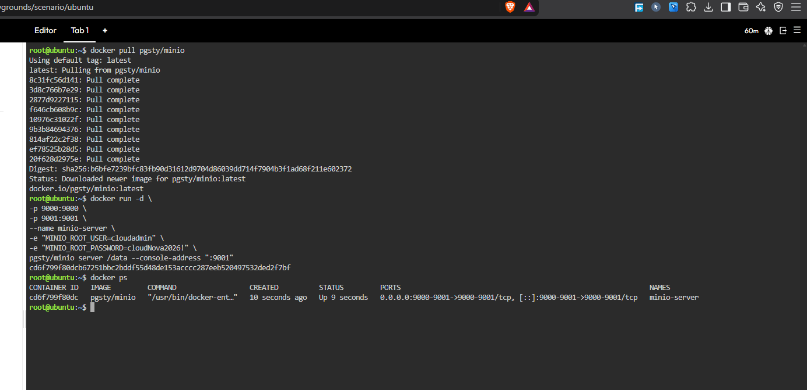
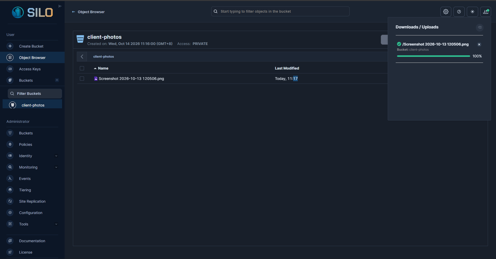

# 🪣 MinIO Deployment
### *One Command, One Storage Server*

> 🎙️ *"From empty Ubuntu playground to live object storage."*

---

## 🧾 Deployment Snapshot

| Field | Details |
|---|---|
| 🧰 Tool | MinIO (S3-compatible object storage) |
| 🐧 Environment | KillerCoda Ubuntu Playground |
| 📦 Container Name | `minio-server` |
| 🌐 Web Console Port | **9001** |
| 🔌 API Port | **9000** |
| 🪣 Bucket Created | **client-photos** |

---

## ⌨️ The Exact Docker Command

```bash
docker run -d -p 9000:9000 -p 9001:9001 --name minio-server \
-e "MINIO_ROOT_USER=cloudadmin" \
-e "MINIO_ROOT_PASSWORD=CloudNova2026!" \
minio/minio server /data --console-address ":9001"
```

Then I verified it was running with:

```bash
docker ps
```

[Add one sentence about what you saw, such as the container name, the `Up` status, and the `9000` and `9001` ports.]

---

## 🔍 Breaking the Command Down

| Part | What it does |
|---|---|
| `-d` | Runs the container in the background (detached mode) |
| `-p 9000:9000` | Maps host port 9000 to the container's API port |
| `-p 9001:9001` | Maps host port 9001 to the container's web console port |
| `--name minio-server` | Gives the container a name I can refer to later |
| `minio/minio` | The MinIO image pulled from Docker Hub |
| `server /data` | Starts MinIO and stores its data in the `/data` folder |
| `--console-address ":9001"` | Tells MinIO to serve the web console on port 9001 |

---

## 🔑 What the `-e` Flags Did

`-e` sets an **environment variable** inside the container when it starts. That means I could configure MinIO without editing any config file.

- `MINIO_ROOT_USER=cloudadmin` — [explain in your own words: sets the admin username for logging in]
- `MINIO_ROOT_PASSWORD=CloudNova2026!` — [explain in your own words: sets the admin password]

---

## 🪜 Steps I Took in the Console

1. Opened the **Traffic / Ports** menu in KillerCoda, entered port `9001`, and clicked **Access**
2. Logged in with the `cloudadmin` credentials from the command
3. Went to **Buckets → Create Bucket** and named it `client-photos`
4. Opened the bucket and used **Upload** to add [name of your file]

---

## 📸 Evidence


*Caption: `docker run` and `docker ps` showing `minio-server` running.*


*Caption: The `client-photos` bucket with the uploaded file.*


