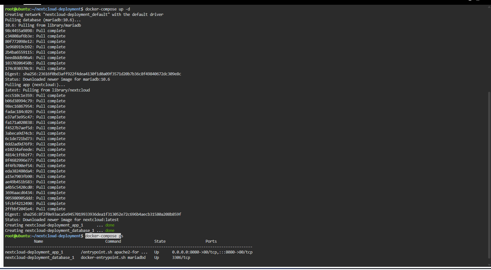
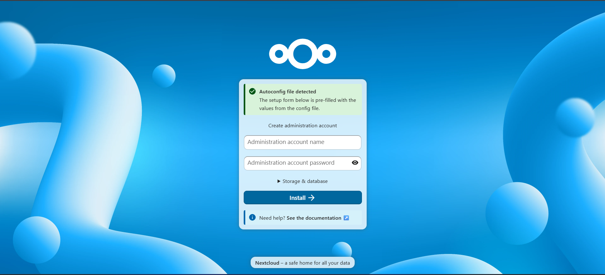
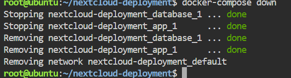

# 🧱 Laboratory 6 — The Cloud Deployment Engineer
### *CloudNova Technologies — Cloud Deployment Team*

---

## 🚀 Mission Overview

A university wants to stop paying for Google Drive and host its own private cloud storage. They picked **Nextcloud**, which needs a database behind it to store user credentials and file metadata. That makes it a two-tier application: a Nextcloud web container and a MariaDB database container.

Instead of starting each container by hand, I wrote a `docker-compose.yml` file in nano inside the KillerCoda Ubuntu Playground, deployed both containers with one command, opened Nextcloud's setup screen through port forwarding, and then tore the whole stack down with another single command. This was my jump from running commands to Infrastructure as Code.

---

## 🎯 Objectives

- [x] Explain the concept of a multi-tier application architecture
- [x] Understand the purpose and structure of a `docker-compose.yml` file
- [x] Use a Linux command-line text editor (nano) to create configuration files
- [x] Deploy a multi-container application (Nextcloud + Database) using Docker Compose
- [x] Document deployment procedures and IaC principles using Markdown
- [x] Continue expanding my GitHub Cloud Computing Portfolio

---

## ⌨️ Commands Executed

| # | Command | What I was doing |
|---|---|---|
| 1 | `mkdir nextcloud-deployment` | Creating a project folder |
| 2 | `cd nextcloud-deployment` | Moving into it |
| 3 | `nano docker-compose.yml` | Writing the Compose file |
| 4 | `docker-compose up -d` | Deploying both containers in the background |
| 5 | `docker-compose ps` | Checking that both containers were running |
| 6 | `docker-compose down` | Stopping and removing the whole stack |

*(The code behind these is explained in [`docker-compose-guide.md`](./docker-compose-guide.md).)*

---

## 🧠 Skills Learned

- What a multi-tier architecture is and why the tiers are kept separate
- Reading and writing a `docker-compose.yml` file, including strict YAML indentation
- Creating and saving a file with the nano editor
- Deploying and tearing down a multi-container stack with one command each
- Linking containers with a service name instead of an IP address

---

## 📁 What's Inside This Mission Folder

| File | Purpose |
|---|---|
| 📄 `multi-tier-architecture.md` | Two-tier architecture and why the tiers are separated |
| 🧾 `docker-compose-guide.md` | The YAML explained line by line, for the next engineer |
| 🪞 `reflection.md` | What this mission taught me |
| 📸 `screenshots/` | Visual evidence of the mission |

---

## 📸 Evidence

*Caption: `docker-compose up -d` and `docker-compose ps` showing both containers running.*

*Caption: The Nextcloud setup screen, reached through port 8080.*

*Caption: `docker-compose down` stopping and removing the stack.*

---

## ✅ Mission Status

- [x] Checkpoint 1 — Portfolio expanded
- [x] Checkpoint 2 — Multi-tier architecture researched
- [x] Checkpoint 3 — Infrastructure code written
- [x] Checkpoint 4 — Stack deployed
- [x] Checkpoint 5 — Private cloud accessed and torn down
- [x] Checkpoint 6 — Technical documentation written
- [x] Checkpoint 7 — Reflection written
