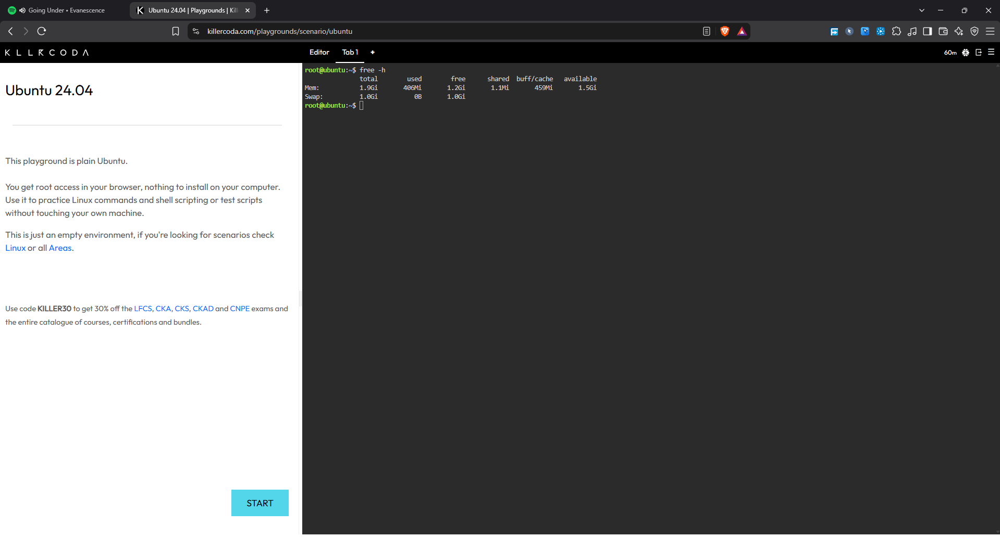
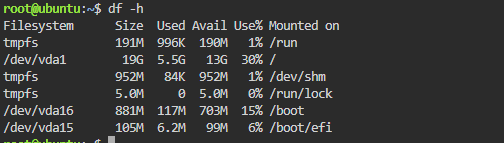
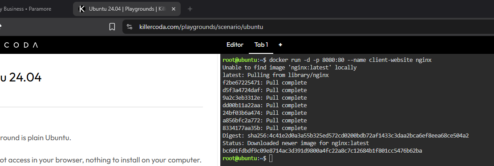
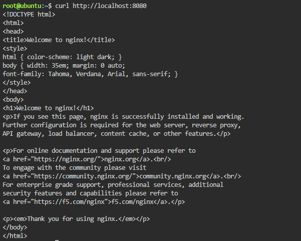
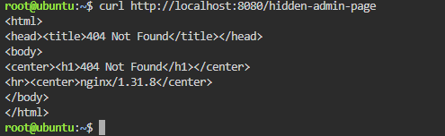
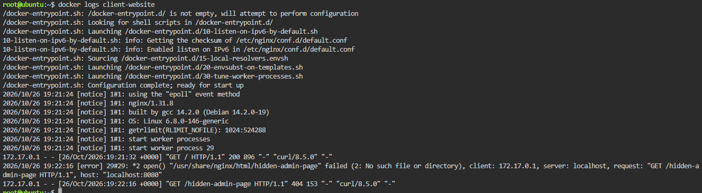
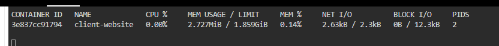

# 📡 Laboratory 7 — The Cloud Operations Engineer
### *CloudNova Technologies — Cloud Operations Team (SRE)*

---

## 🚀 Mission Overview

A client is about to launch a massive marketing campaign and is worried their cloud servers will run out of memory and crash when thousands of users hit the site at once. My job as a Cloud Operations Engineer was to prove the infrastructure was ready, not just hope it was.

In the KillerCoda Ubuntu Playground, I first measured the host server's baseline (RAM, disk, and CPU load). Then I deployed the client's Nginx web server as a container named `client-website`, sent it three normal requests and one request to a page that doesn't exist, and pulled its logs and real-time metrics. A developer hopes the application works; a Site Reliability Engineer uses metrics and logs to prove it.

---

## 🎯 Objectives

- [x] Use native Linux command-line tools to monitor host CPU, memory, and disk capacity
- [x] Deploy a web container and track its real-time performance using Docker metrics
- [x] Generate web traffic and extract application access logs for analysis
- [x] Translate raw performance data into a readable technical report using Markdown
- [x] Continue expanding my GitHub Cloud Computing Portfolio

---

## ⌨️ Monitoring Commands Executed

| # | Command | What I was doing |
|---|---|---|
| 1 | `free -h` | Checking the host's memory (RAM) |
| 2 | `df -h` | Checking the host's disk storage |
| 3 | `top` | Watching running processes and CPU load |
| 4 | `docker run -d -p 8080:80 --name client-website nginx` | Deploying the client's web server |
| 5 | `curl http://localhost:8080` (×3) | Simulating three normal visits |
| 6 | `curl http://localhost:8080/hidden-admin-page` | Triggering a 404 error on purpose |
| 7 | `docker logs client-website` | Reading the container's access logs |
| 8 | `docker stats` | Watching live CPU, memory, and network usage |

*(The results are explained in [`system-baseline-report.md`](./system-baseline-report.md) and [`container-observability.md`](./container-observability.md).)*

---

## 🧠 Skills Learned

- Establishing a host baseline with `free`, `df`, and `top`
- Generating test traffic, including a deliberate error, with `curl`
- Finding 200 and 404 responses in an application's access logs
- Reading CPU, memory, and network figures from `docker stats`
- Telling logs (what happened) apart from metrics (how much is being used)

---

## 📁 What's Inside This Mission Folder

| File | Purpose |
|---|---|
| 📊 `system-baseline-report.md` | Host RAM, disk, and CPU baseline |
| 🔭 `container-observability.md` | The 404 log line and live container metrics |
| 🪞 `reflection.md` | What this mission taught me |
| 📸 `screenshots/` | Visual evidence of the mission |

---

## 📸 Evidence

*Caption: Host memory from `free -h`.*

*Caption: Host disk capacity from `df -h`.*

*Caption: Deploying the `client-website` container.*

*Caption: Three successful requests to the site.*

*Caption: The 404 Not Found response from `/hidden-admin-page`.*

*Caption: Access logs showing three 200s and one 404.*

*Caption: Live CPU, memory, and network usage from `docker stats`.*

---

## ✅ Mission Status

- [x] Checkpoint 1 — Portfolio expanded
- [x] Checkpoint 2 — Host baseline established
- [x] Checkpoint 3 — Web server deployed and traffic generated
- [x] Checkpoint 4 — Application logs analyzed
- [x] Checkpoint 5 — Container metrics captured
- [x] Checkpoint 6 — Technical documentation written
- [x] Checkpoint 7 — Reflection written
